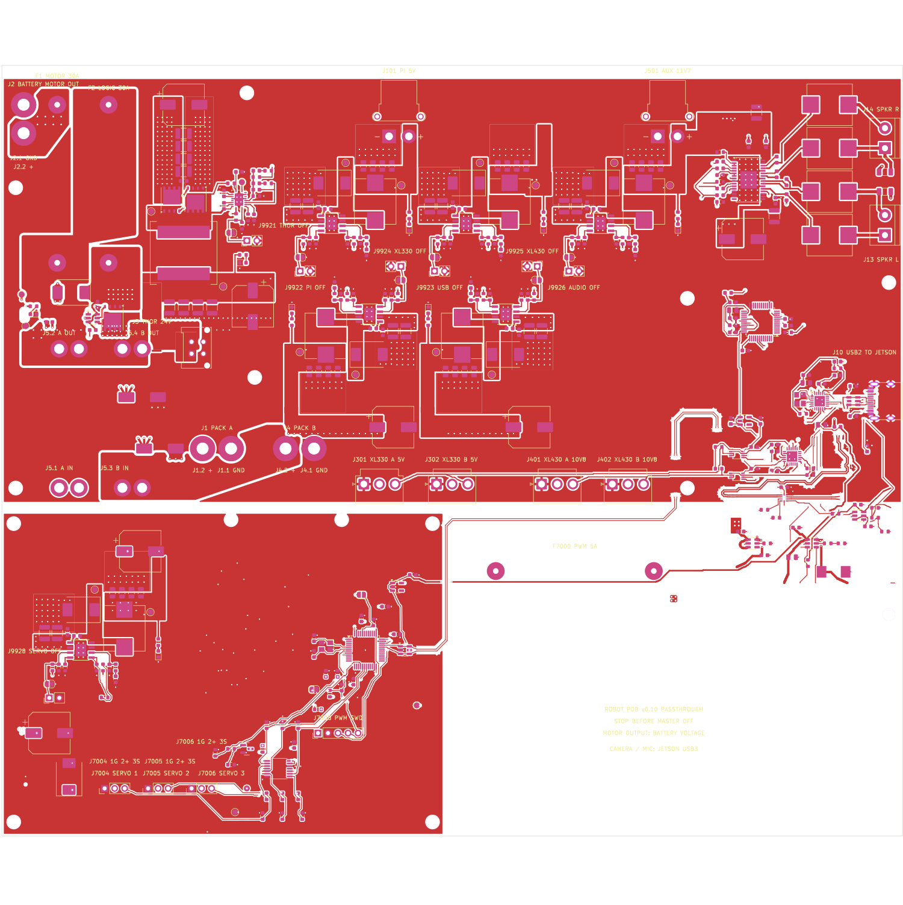

# Logan's first robot PCB

A power distribution and USB board for a two-wheeled robot with a Jetson AGX
Thor, Dynamixel servos and two 8S battery packs. It is my first real board,
it was designed with heavy help from AI coding agents, and **it has not been
built yet**. I'm publishing it to get it reviewed before I spend money on it.

> **Status (10 November 2026): on hold, not ordered.** An unpaid JLCPCB quote
> exists at $294.18 for five boards with two assembled. A late review raised
> a question about inductor voltage ratings (see [Open questions](#open-questions)),
> so I have not paid. Nothing here has been measured on hardware.

## What it does

| Function | Detail |
|---|---|
| Battery input | Two 8S packs (27–33.6 V), each fused at the pack, through an external mechanical DPST master switch |
| Motor output | Fused battery-voltage passthrough to existing motor controllers (about 10 A in my use) |
| Jetson Thor | 24.3 V at up to 8 A, LM5146 synchronous buck |
| Servo rails | 5 V (XL330), 10.8 V (XL430) and a separate 5 V (three MG90S), each a TPS54560 buck |
| Spare outputs | 5 V / 5 A and 11.7 V / 5 A on XT30 connectors |
| Audio | CM108B USB codec and TPA3118 stereo amplifier |
| USB | One USB-C to the Jetson; CH334F hub to audio, a CH342F dual UART for Dynamixel, and an STM32F072 that generates three servo PWM signals |

Four layers, 228 × 195 mm, 1 oz outer / 0.5 oz inner copper. 366 footprints, of which 304 are fitted by the factory.

## Look at it without installing anything

- **[Plain-language walkthrough](https://jloganolson.github.io/logans-first-robot-pcb/)**: what plugs in where, what it costs, what the risks are
- **[Schematic (PDF)](renders/schematic.pdf)**. See the caveat about its style below.
- Copper layers: [top](renders/top-copper.png), [inner 1, ground](renders/inner1-ground.png), [inner 2, power](renders/inner2-power.png), [bottom](renders/bottom-copper.png), and the [assembly drawing](renders/assembly-top.png)
- Open the real board in your browser with KiCanvas: [board](https://kicanvas.org/?github=https://github.com/jloganolson/logans-first-robot-pcb/blob/main/revisions/v0.10/kicad/robot_pdb.kicad_pcb), [schematic](https://kicanvas.org/?github=https://github.com/jloganolson/logans-first-robot-pcb/blob/main/revisions/v0.10/kicad/robot_pdb.kicad_sch). The board file is about 6 MB, so it may be slow.
- KiCad 7 project: [`revisions/v0.10/kicad/`](revisions/v0.10/kicad/)

## Open questions

These are what I most want a second opinion on. Short answers are welcome;
"that's fine, everyone does it" is as useful to me as "don't".

1. **Inductor voltage ratings.** The molded inductors in every buck converter
   here are rated 30 V by their makers (Sunlord MWSA1004S on six rails;
   Cjiang FEXL1510A on the Thor rail, whose datasheet says "absolute maximum
   voltage: DC 30V"). The packs reach 33.6 V. At start-up, or into a shorted
   output, the full input voltage sits across the inductor for each on-time.
   Is that a real reliability problem, or a rating that only matters in
   steady state? Would you pay about $15–30 more for 60–75 V parts?
2. **Thor buck current limit.** LM5146 with low-side RDS(on) sensing,
   R13 = 220 Ω, BSC034N06NS FETs. I calculate a typical valley limit near
   14 A (scaled from about 12 A at the earlier 180 Ω), a worst-case low near 8.5 A of load, and a worst-case inductor peak
   near 26 A against a 29 A typical saturation figure. Two reviewers read the
   comparator offset's sign differently. See the [review handoff](docs/HANDOFF_V10_VALUE_ENGINEERED.md).
3. **USB 2.0 High-Speed pair.** 0.275 mm traces with a 0.19 mm gap over
   0.21 mm of 7628 prepreg (JLCPCB's calculator gives 90 Ω at 0.269 / 0.175).
   No impedance test coupon. Two older Full-Speed routes have
   [known reference-plane compromises](docs/V09_USB_PROTOTYPE_REVIEW.md).
4. **Heat.** A simple model from the real copper puts the hottest regulator
   about 45 °C above ambient at 4 A in still air ([map](renders/thermal-map.png),
   [model](red-team-findings/2026-11-10/thermal/)). Sensible, or a sign the
   1 oz / 0.5 oz copper is too thin?
5. **Assembly process.** JLCPCB's Economic line reflows at a fixed
   255 ± 5 °C. A reviewer reports a 250 °C case limit for the nine 10 × 10 mm
   electrolytic capacitors. Also: lead-free HASL under a 1.5 × 2 mm UQFN-10.
6. **Anything alarming** in the input protection (ideal-diode controller,
   TVS, fusing) or anywhere else.

## How to give feedback

Open an [issue](https://github.com/jloganolson/logans-first-robot-pcb/issues).
One issue per concern is easiest. Screenshots and "look at this net" pointers
are plenty; you don't need to propose a fix.

## How this was made, and what that means for you

- **AI-assisted and script-generated.** The schematic and layout were produced
  by Python scripts driving KiCad, written by AI agents under my direction.
  The scripts are in [`source/`](source/). Many of the older ones refer to
  earlier revisions that are not in this repository and will not run as-is.
- **The schematic is not a conventional drawing.** It is generated from a
  parts list: components are grouped by function and connected by net labels,
  with no drawn wires. It is electrically complete and matches the board, but
  it is harder to read than a hand-drawn schematic. Sorry.
- **v0.10 is a cost-reduced copy of v0.9.** A script
  ([`build_v10.py`](source/generator/build_v10.py)) takes the earlier, more
  expensive v0.9 board and applies a fixed list of changes: thinner copper,
  a shorter outline, standard via sizes, wider USB traces for the standard
  stack-up, and four part substitutions. Every change is recorded in
  [`derivation.json`](revisions/v0.10/derivation.json).

## What has been checked

- KiCad DRC: 0 errors, 0 unconnected pads, 13 warnings carried over from v0.9.
- A [difference audit](source/fabrication/audit_v10.py) proving v0.10 differs
  from v0.9 only in the recorded ways, and that schematic and board agree.
- JLCPCB accepted the files, matched all 81 BOM lines and priced the order.
- Three AI reviews. Their reports, including the places they were wrong, are
  in [`red-team-findings/`](red-team-findings/2026-11-10/).

Not done: no board has been built, powered or measured. The thermal and
impedance figures are calculations.

## Ordering it from JLCPCB

Everything specific to JLCPCB is in [`manufacturing/jlcpcb/`](manufacturing/jlcpcb/):
Gerbers, BOM with their part numbers, placement file, the dated quote, and an
[order recipe](manufacturing/jlcpcb/ORDER_RECIPE.md) listing every option and
the mistakes that cost time to find. **Please don't order it as-is** while the
inductor question is open.

## Repository map

| Path | Contents |
|---|---|
| `revisions/v0.10/` | The current board: KiCad project, change record, DRC report |
| `revisions/v0.9/` | The earlier board v0.10 is derived from |
| `renders/` | Schematic PDF, layer images, thermal map |
| `manufacturing/jlcpcb/` | Order files and recipe |
| `docs/` | Walkthrough, review handoff, bring-up checklist, design notes |
| `red-team-findings/` | Cost review, AI review reports, thermal model |
| `source/` | Generator, audit and export scripts |
| `outputs/` | Audit results and the exact uploaded package |
| `firmware/robot_io/` | Firmware for the servo PWM controller (third-party USB stack not included; see its README) |

## License

MIT; see [LICENSE](LICENSE). Footprints and symbols taken from the KiCad
libraries remain under their own license (CC BY-SA 4.0 with the KiCad
library exception). This is an unbuilt prototype with known open issues and
comes with no warranty of any kind. It handles battery power: if you build
anything from it, fuse it and test it carefully.
